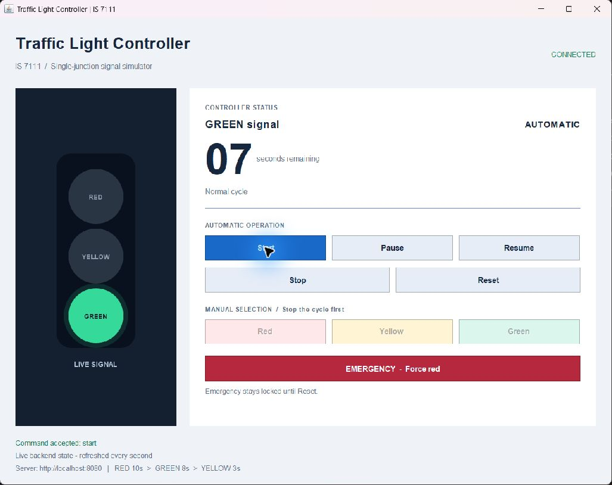

# Traffic Light Controller

IS 7111 - Advanced Programming Practicum, Continuous Assessment 01.

A Java Swing desktop application and an independent Spring Boot REST server simulate a single-junction traffic signal. The backend owns the light, mode, countdown and emergency lock. The client displays backend snapshots and sends HTTP commands.



## Required technologies and selected tools

| Technology | Requirement / use |
| --- | --- |
| Java 17 or later | Required; both projects compile for Java 17. |
| Java Swing / AWT / Java2D | Required desktop UI; three visible lights and all controls. |
| Spring Boot REST | Required backend; Spring Boot 3.5.7 with Spring Web and embedded Tomcat. |
| HTTP + JSON | Required communication; JDK `HttpClient` and Jackson in the client. |
| Scheduled task and thread safety | Required; one Spring scheduled task, monotonic timing and synchronized service methods. |
| Memory-only state | Required; no database, JPA, H2 or state-file persistence. |
| Maven 3.9.11 | Chosen build tool; official Maven wrapper included. Not mandated by the brief. |
| JUnit 5, Spring Boot Test / MockMvc | Chosen automated test tools. |
| GitHub repository + screenshots | Required submission format; screenshots included in `docs/screenshots/`. |

No browser frontend, JavaFX, Node.js, Docker or database is needed to run this solution.

## Start on Windows

1. Install a JDK 17 or later. Ensure `java -version` and `javac -version` work. If needed, set `JAVA_HOME` to your JDK folder.
2. Extract this project. Open a terminal in this folder.
3. Build and run all tests:

   ```powershell
   .\build-and-test.cmd
   ```

4. Start the backend in one terminal:

   ```powershell
   .\run-server.cmd
   ```

5. Start the desktop in another terminal:

   ```powershell
   .\run-client.cmd
   ```

The initial state is RED / STOPPED / 0. The default server is `http://localhost:8080`. On the first build, the wrapper downloads Maven and Maven downloads dependencies, so internet access is needed. Subsequent application runs need no internet. Close the desktop window to stop its worker; press Ctrl+C in the server terminal to stop the backend.

The delivered ZIP also includes both prebuilt executable JARs in the project `target` folders, so you can run steps 4 and 5 immediately with Java 17+. Run step 3 whenever you want to rebuild and reproduce the tests. Git ignores those build folders when preparing the source submission.

The run scripts build missing JARs. After editing source, run `build-and-test.cmd` again to replace existing JARs.

## Other operating systems / IDEs

The two `pom.xml` files are independent Maven projects. Import `server/pom.xml` and `client/pom.xml` into IntelliJ IDEA, Eclipse or NetBeans, selecting Java 17+. Run `TrafficServerApplication`, then `TrafficClientApplication`.

On macOS/Linux, from the repository folder:

```sh
sh mvnw -f server/pom.xml clean verify
sh mvnw -f client/pom.xml clean verify
java -jar server/target/traffic-server-1.0.0.jar
# In another terminal:
java -jar client/target/traffic-client-1.0.0.jar
```

To change the port:

```powershell
.\run-server.cmd --server.port=8081
.\run-client.cmd http://localhost:8081
```

The backend binds to loopback by default. Both programs run on the same computer. The client accepts a server origin as its first argument.

## Operation

- **Start:** begin a fresh RED 10s -> GREEN 8s -> YELLOW 3s cycle, repeating indefinitely.
- **Pause / Resume:** freeze the current phase and its exact remaining duration; continue from that point.
- **Stop:** return to RED / STOPPED / 0.
- **Manual Red / Yellow / Green:** available while STOPPED or already MANUAL. Countdown is 0.
- **Emergency:** force RED / EMERGENCY / 0 and latch the emergency flag. Start, Resume and Manual are blocked until Reset.
- **Reset:** clear manual/emergency state and return to RED / STOPPED / 0.
- **Resume before Pause:** deliberately remains available when connected, allowing the required invalid-operation demonstration; the server returns HTTP 409.

**Stop during an emergency:** Stop returns RED / STOPPED / 0 but keeps `emergency=true`. Reset is the only operation that clears this latch. This satisfies the Stop output requirement while preventing a Stop -> Start bypass of the emergency rule.

If the backend goes offline, the client dims all lamps, displays `--` instead of a live countdown, labels the last known signal as stale, disables remote operations and retries automatically. The window remains responsive.

## Project structure

```text
server/                  Independent Spring Boot Maven project
  src/main/java/.../
    controller/          REST mappings and HTTP error handling
    service/             Synchronized state machine and one scheduled task
    model/               Light, mode and immutable state record
  src/test/              Timing, concurrency and REST tests
client/                  Independent Swing Maven project
  src/main/java/.../
    api/                 HTTP / JSON communication
    model/               Response record and enums
    ui/                  Swing window and three-lamp signal painting
    ClientCoordinator    Background polling, action queue and EDT callbacks
  src/test/              HTTP contract, offline and EDT responsiveness tests
docs/                    Requirements mapping, API and test evidence
.mvn/wrapper/            Maven distribution configuration
mvnw / mvnw.cmd          Official Apache Maven wrapper scripts
```

No server classes are imported by the client. The applications communicate only over HTTP.

## Submission

GitHub repository: [IS7111 Traffic Light Controller](https://github.com/AnjanaInda01/IS7111-Traffic-Light-Controller)

- [Screenshot and implementation report PDF](docs/report/IS7111_CA01_Traffic_Light_Controller_Report.pdf)
- [Editable Word report](docs/report/IS7111_CA01_Traffic_Light_Controller_Report.docx)
- [Requirements mapping](docs/REQUIREMENTS.md)
- [API reference](docs/API.md)
- [Verification record](docs/TESTING.md)

The brief specifies 20 November 2026 before 11:00 pm and a GitHub repository plus screenshots. Source, tests and screenshots are included. The report contains the repository link. Course submission through the LMS remains the student's responsibility. Ensure the marker has repository access before submitting its URL.

Build folders and IntelliJ user settings are excluded from Git.

## References

- Assignment brief: CA I.pdf, IS 7111, supplied by the user.
- [Spring Boot installation and Maven guidance](https://docs.spring.io/spring-boot/installing.html)
- [Spring Boot 3.5 system requirements](https://docs.spring.io/spring-boot/3.5/system-requirements.html)
- [Apache Maven Wrapper](https://maven.apache.org/wrapper/)
- [Java 17 Swing API](https://docs.oracle.com/en/java/javase/17/docs/api/java.desktop/javax/swing/package-summary.html)
- [Java 17 HttpClient API](https://docs.oracle.com/en/java/javase/17/docs/api/java.net.http/java/net/http/HttpClient.html)

The Maven wrapper scripts are provided by the Apache Software Foundation under Apache License 2.0; their license headers are retained.
